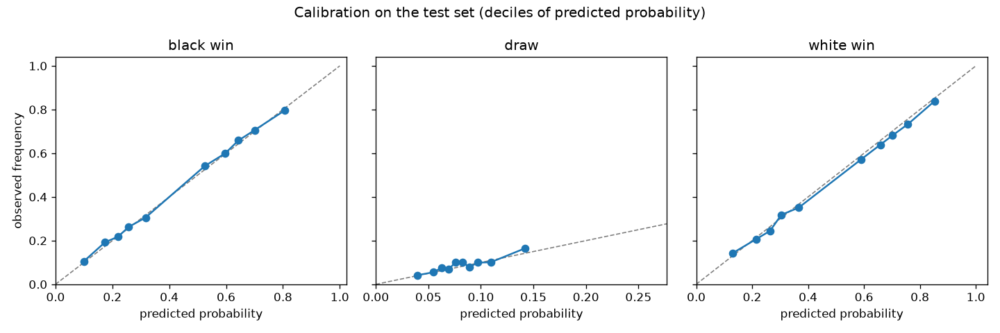
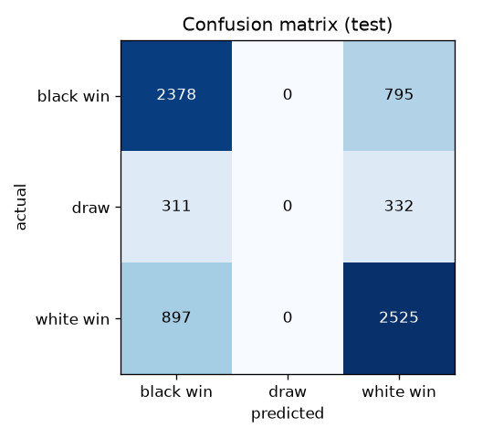
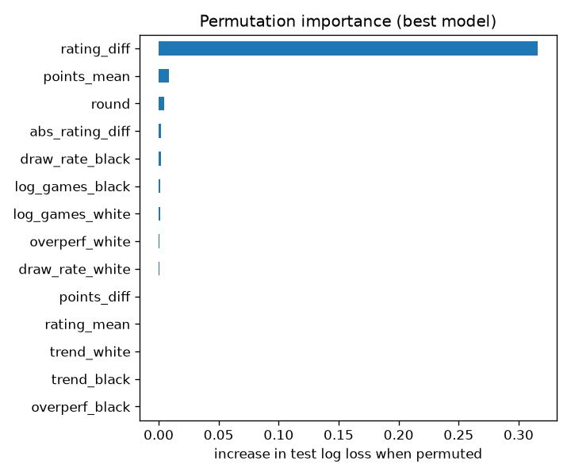

# Predicting Titled Tuesday results from pre-game information

**Task (Option A):** predict White win / draw / Black win for Titled Tuesday
games using only what is known before the game starts.

**Bottom line.** On 7,238 held-out games from the four March 10–31 events, the
selected model (multinomial logistic regression on 14 pre-game features)
reaches **log loss 0.795** and **accuracy 67.7%**, against 0.931 / 47.3% for
predicting the class frequencies. Almost all of that comes from the **pre-game
rating difference**: a rating-only baseline already gets 0.799 / 67.7%. The
other features add a small but statistically reliable improvement
(−0.0036 log loss, 95% CI [−0.006, −0.001], better in each of the four test
events), mostly by recognising which games are more likely to be **drawn**.
Probabilities are well calibrated.

The most important finding is about **leakage**: the rating that the
Chess.com API attaches to each game is the player's rating *after* that game.
Using it gives a "free" 0.029 log-loss improvement — about eight times more
than all of the legitimate features combined — that would vanish in
production. The pipeline therefore reconstructs every player's rating as it
stood just before each game.

All numbers below are produced by `python run.py` and are in
[reports/results.md](reports/results.md) / [reports/metrics.json](reports/metrics.json).

---

## 1. Data

| | |
|---|---|
| Events | All 13 weekly Titled Tuesdays, 6 Jan – 31 Mar 2026 (11-round Swiss, 5+0 blitz), incl. the 10 Feb and 10 Mar events named in the brief |
| Games | 24,786 (24,629 modelled; 157 excluded, see below) |
| Outcomes | White wins 48.1%, Black wins 43.5%, draws 8.4% (White scores 52.3%) |
| Player history | 399,401 rated blitz games from the participants' monthly archives (Dec 2025 – Mar 2026) |

**Collection.** The API has no "list tournaments" endpoint, so the event list
was recovered from regular participants' `/player/{user}/tournaments` and
pinned in `config.py` (`ttpredict.discover` reproduces it). Each event is
walked tournament → rounds → groups → games. For each participant, the
monthly archive for the month of each event and for the 30 days before it is
downloaded and slimmed to rated standard blitz games. All responses are cached
on disk.

**Exclusions.** 157 games (0.6%) have a player with no rated blitz game in the
downloaded window before the game, so there is no pre-game rating to use.
Those are dropped. That condition is knowable before the game, so dropping
them doesn't bias anything with future information.

## 2. Leakage: what I checked and how it shaped the design

**The per-game rating is a post-game rating.** For a player's consecutive
rounds *r* and *r+1*, the rating change between the two game records has the
sign of the result in round *r+1* in 99.3% of decisive games, and the sign of
the round-*r* result only 45.9% of the time. So `white.rating` / `black.rating`
(and the PGN's `WhiteElo` / `BlackElo`) already include the result of the game
they are attached to. These columns are kept only as `*_rating_post`, for the
leakage demonstration and checks.

**Reconstructing the pre-game rating.** A player's rating going into a game is
the post-game rating of their previous rated blitz game. The previous game is
taken from the player's full archive, restricted to games that ended at or
before this game's start time. The start time comes from the PGN's `UTCDate`
and `UTCTime` tags. Check on real data: for 43,827 cases where a player also
played the previous round, the reconstructed rating equals that round's
post-game rating **99.98%** of the time. All 10 mismatches are players who
played an extra blitz game between rounds, where the archive-based value is
the correct one.

**Other rules applied to every feature:**

* Recent-form features use only games that ended **before the tournament
  started**.
* Tournament-state features use only **earlier rounds** of the same event.
* Nothing derived from the game itself is used: opening/ECO, moves, duration,
  termination, final standings and placements are all excluded.
* Players' current stats/profile endpoints are never used, because they
  describe the present, not the time of the game.
* The draw-rate shrinkage prior is computed from games that ended before the
  first event in the dataset.
* `tests/test_features.py` enforces this. It randomises the result and
  post-game ratings of a game and of every later game, then asserts that the
  game's features don't change.

**Closed accounts.** 28 participants' accounts have since been closed, 4 of
them for fair-play violations. A naive pipeline could leak this: if their data
were missing, "missing" would mean "later banned". I checked, and the API
still serves those players' archives, so their features are as complete as
anyone else's. The pipeline still excludes, rather than imputes, any player
whose archive returns 404/410, in case that changes in a future pull.

## 3. Features

All features are from White's perspective. Ratings are reconstructed pre-game
ratings.

| feature | idea |
|---|---|
| `rating_diff` | White minus Black pre-game rating, the main signal |
| `abs_rating_diff` | closeness of the pairing; close games are drawn more often |
| `rating_mean` | strength level of the game |
| `round` | Swiss pairings tighten as the event progresses |
| `points_diff`, `points_mean` | points from earlier rounds; top boards play differently |
| `overperf_white/black` | points so far minus Elo-expected points so far ("form today") |
| `trend_white/black` | rating change over the 30 days before the event |
| `log_games_white/black` | log(1 + rated blitz games in those 30 days): activity / rust |
| `draw_rate_white/black` | each player's draw rate in those 30 days, shrunk toward the prior with 20 pseudo-games |

Points from byes are not visible in the game list, so `points_*` slightly
undercounts for players who had a bye.

## 4. Split and model selection

* **Temporal split by whole tournament.** Train on the 9 events from 6 Jan to
  3 Mar (17,391 games); test on the 4 events from 10 to 31 Mar (7,238 games).
  The code asserts that every test game starts after every training game.
  Games were never shuffled across time. Splitting at random would have mixed
  rounds of the same event across train and test and inflated scores.
  Players appear in both periods, as they would in production.
* **Hyper-parameters** are chosen by expanding-window cross-validation inside
  the training period: for each of the last four training events, fit on all
  earlier events and score on that event. The selection criterion is mean log
  loss. The final model is also chosen on CV log loss, before the test set is
  scored, and the test set is scored once.
* **Models:**
  * class prior;
  * **Elo baseline**: logistic regression on `rating_diff` and
    `abs_rating_diff` only;
  * multinomial **logistic regression** on all features;
  * **gradient-boosted trees** (`HistGradientBoostingClassifier`) on all
    features, 72-setting grid.
* **Metric.** The primary metric is log loss, a proper scoring rule. With a
  rare draw class, the quality of the probabilities matters more than the
  arg-max label. Brier score, accuracy, macro-F1 and ROC AUC are reported
  alongside. Confidence intervals are 95% intervals from 1,000 bootstrap
  resamples of the test games. Differences against the Elo baseline are
  bootstrapped **paired**, so both models are scored on the same resampled
  games.

## 5. Results (test set: March 10–31, 7,238 games)

| model | log loss [95% CI] | Δ vs Elo [95% CI] | accuracy [95% CI] | Brier | ROC AUC (ovr) |
|---|---|---|---|---|---|
| class prior | 0.9312 [0.920, 0.942] | +0.1325 | 0.473 [0.461, 0.485] | 0.5766 | 0.500 |
| Elo baseline | 0.7987 [0.784, 0.814] | — | 0.677 [0.667, 0.688] | 0.4646 | 0.706 |
| **logistic regression (selected)** | **0.7952** [0.780, 0.811] | **−0.0036** [−0.006, −0.001] | 0.677 [0.668, 0.688] | 0.4635 | 0.715 |
| gradient boosting | 0.7949 [0.780, 0.810] | −0.0038 [−0.007, −0.001] | 0.677 [0.667, 0.687] | 0.4634 | 0.711 |
| *leaky: post-game ratings* | *0.7695* | *−0.0292* | *0.678* | | |

CV log loss on the training events was 0.7812 for Elo, 0.7774 for logistic
regression and 0.7781 for boosting. Logistic regression was therefore selected
before the test set was seen. It happens to be 0.0003 behind boosting on test,
well within noise.

The full-feature model beats the Elo baseline in each test event:

| event | Elo | logistic regression |
|---|---|---|
| Mar 10 | 0.7594 | 0.7565 |
| Mar 17 | 0.7923 | 0.7903 |
| Mar 24 | 0.8294 | 0.8251 |
| Mar 31 | 0.8250 | 0.8190 |

**Where the extra features help: draws.**

| model | draw ROC AUC | draw rate among the 10% of games with the highest P(draw) |
|---|---|---|
| Elo baseline | 0.577 | 12.3% |
| logistic regression | 0.601 | 16.4% |
| gradient boosting | 0.591 | 15.6% |

The base draw rate on test is 8.9%. The draw rate rises through an event as
Swiss pairings get closer:

| round | 1 | 2 | 3 | 4 | 5 | 6 | 7 | 8 | 9 | 10 | 11 |
|---|---|---|---|---|---|---|---|---|---|---|---|
| draw rate | 6.1% | 7.8% | 7.4% | 8.8% | 8.5% | 7.3% | 9.3% | 9.2% | 9.9% | 9.5% | 10.0% |
| median rating gap | 404 | 316 | 255 | 233 | 216 | 200 | 186 | 177 | 168 | 162 | 158 |

(All 24,629 modelled games, train and test.)

The logistic-regression coefficients agree with chess intuition. Draws become
more likely with a higher `points_mean` (the leaders, playing on the top boards), with
drawish players (`draw_rate_*`) and with a smaller rating gap. With points held
fixed, a later round makes draws *less* likely. The raw draw rate still rises
by round because points and rating closeness rise with it. One plausible
reading is that a given score late in an event means more pressure to play
for a win, but I haven't tested that.

**Calibration** is close to the diagonal for all three classes (above), so the
probabilities can be used as probabilities.

**The model never predicts "draw" as its single most likely outcome**, so
macro-F1 is only 0.47. That's the correct decision rather than a bug. Even
the most draw-prone pairings in this pool have a draw probability far below
the chance that one side wins, so arg-max accuracy can't benefit from
predicting draws. A user who needs draw calls should threshold P(draw)
directly; the lift table above shows it ranks draws meaningfully.

**Permutation importance** on the test set: `rating_diff` dominates (+0.316
log loss when shuffled). It is followed by `points_mean` and `round`, then
small contributions from activity, draw tendency and form. `trend_*` and
`overperf_black` contribute essentially nothing.

## 6. Honest assessment

* **This is mostly an Elo model.** Pre-game rating difference explains nearly
  everything predictable here. The extra features buy about 0.5% relative log loss.
  That gain is statistically real and consistent across events, but small in
  practice. Accuracy doesn't move, because the extra signal is in probabilities
  and draws, not in who wins.
* **Blitz is noisy.** Even with perfect information about strength, 5+0 games
  between titled players have a large irreducible random component. A
  log-loss floor around 0.78–0.80 is unsurprising.
* **No-shows.** Games where a player never moved (≤ 2 plies, lost on time; 164 of the test games) are
  unpredictable from pre-game data. They are kept in the main evaluation
  because they can't be identified in advance. Removing them, as a post-game
  diagnostic only, improves log loss to 0.785 for the selected model.
* **Test period.** Four March events from the same season. The results say
  little about other periods or other formats.
* **Bootstrap intervals** resample games, which treats them as independent.
  Games within an event share players, so the true uncertainty is somewhat
  larger. The per-event table is the more conservative evidence.

## 7. What I would do next

1. **Glicko rating deviation.** Chess.com uses Glicko, so the uncertainty of
   each rating (RD) would weight the rating difference properly. It isn't
   exposed per game, but it could be approximated from activity.
2. **Longer and cross-format history.** Bullet/rapid ratings, head-to-head
   records, and Titled Tuesday-specific performance over many months.
3. **Byes and late joiners.** Reconstruct full standings, including bye
   points, from the tournament's player list round by round.
4. **An ordinal model.** Ordered logit treats loss < draw < win as ordered,
   and would make draw probability peak naturally for even pairings.
5. **More events, grouped uncertainty.** Add April onwards as further test
   periods, and bootstrap by event or player to get honest intervals.

## 8. Time spent and AI usage

The project was built with **Claude Code** (Anthropic's coding agent) driving
the implementation. The full agent transcript accompanies this submission.
Approximate wall-clock split of the agent session:

| part | time |
|---|---|
| Reading the brief, exploring the API, project setup | ~15 min |
| Data collection and discovering the post-game-rating leak | ~15 min |
| Archive download design, features, leakage tests, modelling code | ~30 min (while the ~45 min archive download ran) |
| Real-data run, validation checks, grid widening, fresh-clone reproduction | ~40 min |
| Report | ~20 min |

Total ≈ 2 hours of active session time, plus unattended download and training
runs.
